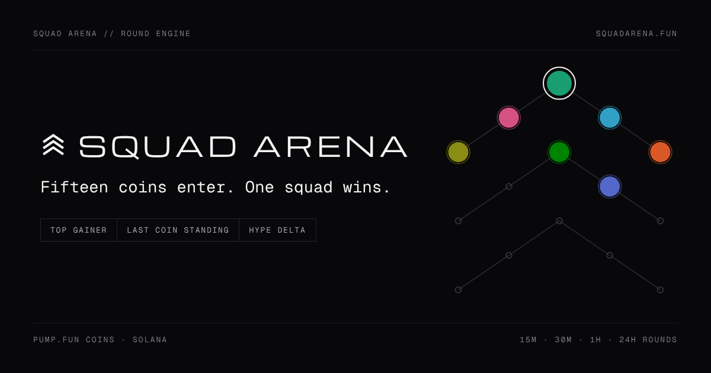

<p align="center">
  
</p>

<h1 align="center">Squad Arena</h1>

<p align="center"><b>Fifteen coins enter. One squad wins.</b><br>
Live rounds on the freshest pump.fun coins, with squads behind every coin.</p>

<p align="center">
  <a href="https://squadarena.fun">squadarena.fun</a>
</p>

---

## What it is

Every round, the fifteen strongest pump.fun coins launched in the last 72 hours enter the arena. Up to ten more wait on deck, greyed out but still bettable. Prices stream live, the board re-ranks every few seconds, and a round settles on real market data.

You back coins in three markets:

| Market | You win when |
|---|---|
| **Top gainer** | your coin has the biggest gain when the round closes |
| **Last coin standing** | your coin survives five cuts (3 · 3 · 3 · 2 · 2) and wins the final duel |
| **Hype delta** | your coin's trading pace grows the most (two pools: most efficient, biggest burst) |

Rounds run on **15 minutes, 30 minutes, 1 hour and 24 hours**. Pools are pari-mutuel: earlier bets get a higher weight, and every bet gets a hashed receipt. Everyone gets practice credits (tSOL); the SOL wallet runs on Solana devnet until mainnet is switched on.

## Squads

Backing a coin makes you a member of its squad. Each squad gets tasks that unlock as the coin's market cap climbs (Ignition, Lift-off, Breakout, Arena, Legend). Members post proof links from X, verify each other's work, and everyone can see who did what.

## The chart

Every coin page has a full trading chart built on [TradingView Lightweight Charts](https://www.tradingview.com/lightweight-charts/):

- price or market cap, 1m to 4h candles, candles, bars, line or area
- free movement in every direction, axis stretching, log and percent scales
- volume, moving averages, EMA, Bollinger Bands, VWAP, RSI and MACD
- trend lines, horizontal lines, a measure tool and full screen

## Data

| Source | Used for |
|---|---|
| pump.fun / GeckoTerminal | discovering new coins |
| DEX Screener | prices, liquidity, volume and trade counts |
| GeckoTerminal | 1-minute and 5-minute candles |
| Solana RPC (QuickNode) | streaming pool balances on every swap |

A gate keeps out thin or spoofed coins: at least $25K liquidity, real turnover and trade counts, and market cap no more than 60 times liquidity. Coins that rug are pulled from the board mid-round.

## How it fits together

| Part | Where it runs | What it does |
|---|---|---|
| Website (`index.html`, `config.js`) | Vercel | The arena, the chart, login, the account sheet |
| Round server (`server/`) | Railway, 24/7 | Finds coins, streams prices (QuickNode), fixes each round's field at the open, runs the cuts, settles bets, streams everything to every open page |
| Database (`supabase/schema.sql`) | Supabase | Accounts, balances, bets, rounds, squads, proofs, chat, ledger, deposits, withdrawals |
| Login | Privy | Google creates a Solana wallet per user; Phantom, Solflare and Backpack connect too |

Only the round server holds secrets. The database is locked to the server's secret key, every bet and payout goes through atomic database functions, and every balance change lands in a ledger that can't credit the same thing twice.

## Set up

1. **Database.** Supabase → SQL Editor → New query → paste `supabase/schema.sql` → Run.
2. **Round server.** Railway → New Project → Deploy from GitHub → this repo. In the service settings set **Root Directory** to `server`. Add these variables:

   | Variable | Value |
   |---|---|
   | `PRIVY_APP_ID` | Privy App ID |
   | `PRIVY_APP_SECRET` | Privy App secret |
   | `SUPABASE_URL` | `https://<project>.supabase.co` |
   | `SUPABASE_SECRET_KEY` | Supabase secret key (`sb_secret_…`) |
   | `QUICKNODE_RPC_URL` | QuickNode mainnet endpoint |
   | `NETWORK` | `devnet` (switch to `mainnet` for real SOL) |
   | `TREASURY_SECRET` | the treasury wallet's secret key (`npm run keygen` prints a new one) |
   | `ALLOWED_ORIGINS` | `https://squadarena.fun,https://www.squadarena.fun,http://localhost:5173` |

   Then Settings → Networking → **Generate Domain**, and check `https://<domain>/health`.
3. **Website.** Put the server's domain in `config.js` as `api`, and Vercel redeploys on push.

Optional server settings: `REAL_MONEY=off` (practice credits only), `SOLANA_RPC_URL`, `WITHDRAW_MAX_SOL` (25), `WITHDRAW_DAILY_SOL` (50), `MIN_STAKE_SOL`, `MAX_STAKE_SOL`, `SEED_SOL`.

## Run it locally

```bash
python3 app/build.py                 # builds index.html from app/src
python3 -m http.server 5173          # the website
cd server && FEED=replay AUTH_DEV=1 SCORE_LATE_ROUNDS=1 node index.js   # a round server on a recorded hour, no outside APIs
```

With `FEED=replay` the server plays a recorded hour of real candles as if it were live, stores everything in memory, and accepts test logins (`AUTH_DEV=1`, never in production). Point a local `config.js` at `http://localhost:8080` with `devAuth: "alice"` to play as a test user.

## Roadmap

- [x] Live board, three markets, four round lengths
- [x] Squads, tasks and proofs
- [x] Trading chart with indicators and drawings
- [x] Privy login: Google creates a Solana wallet per user, Phantom, Solflare and Backpack connect too
- [x] Supabase storage for accounts, bets, squads, proofs and chat, locked to the server
- [x] Round server for coin discovery, the RPC price stream, fields, cuts and settlement
- [x] SOL wallet: deposits and withdrawals through a treasury, devnet first
- [ ] Mainnet: legal review, a fresh treasury key, then `NETWORK=mainnet`
